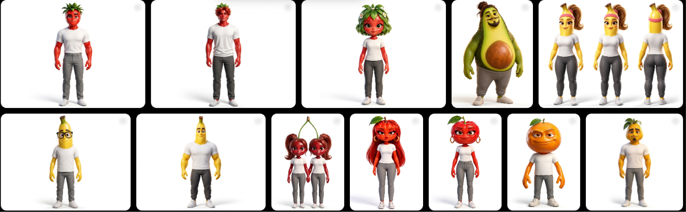
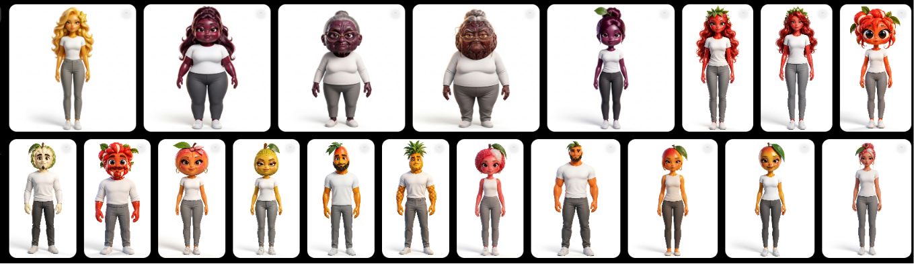
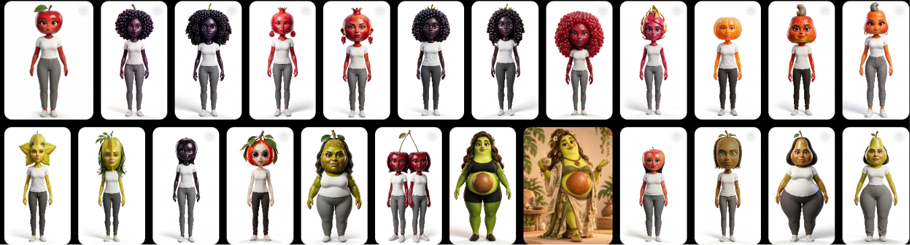
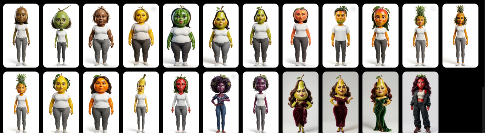

# 🍓 Frutas IA

Gerador estático em HTML, CSS e JavaScript, sem dependências de produção.

## 🎨 Etapa 01 — Identidade visual dos personagens (concluída em 16/10/2026)

A primeira etapa do **Frutas IA** consistiu em experimentar estilos de personagens-fruta até estabelecer uma linguagem visual consistente para a produção de vídeos. Os testes evoluíram de versões mais humanas ou excessivamente fofas para **frutas claramente reconhecíveis, com cabeça de fruta, corpo humanoide e proporções influenciadas pela anatomia de cada espécie**.

A identidade escolhida combina **caricatura 3D surrealista e levemente estranha**, rostos de expressão humana marcante, casca com acabamento **glossy**, cores vivas e renderização cinematográfica. O objetivo é equilibrar estranhamento, humor e beleza visual, evitando personagens que pareçam humanos fantasiados de frutas.

A etapa resultou em dois modelos complementares:

- **Prompt Mestre 3.0 — Personalizado:** permite definir fruta, gênero, idade, corpo, cabelo, roupa, personalidade e expressão facial.
- **Prompt Mestre 3.1 — Modelo-base:** padroniza roupa básica, pose frontal, expressão neutra e fundo branco isolado. Somente fruta, gênero, idade e corpo variam. A imagem-base aprovada servirá de referência para alterações futuras no Flow.

Como desdobramento, foi desenvolvido e publicado o **[Gerador de Personagens Frutas IA](https://amandmendes.github.io/frutas-ia/)**, que automatiza o preenchimento dos dois prompts. A interface aceita português e converte termos conhecidos para inglês por meio de dicionários locais; expressões não reconhecidas exigem revisão.

**Resultado:** identidade visual-base e fluxo de criação definidos. Os prompts mestres ficam preservados, enquanto os personagens individuais poderão ser desenvolvidos e aprovados separadamente.

---

## 🍍 Etapa 02 — Modelos-base principais criados (concluída em 17/10/2026)

Com a identidade visual definida, foram criados os **modelos-base principais do elenco de personagens-fruta**. A conclusão desta etapa foi confirmada pela criadora do projeto, com uma visão geral dos modelos apresentados em imagens.

O conjunto reúne diferentes frutas e variações de gênero, idade, tipo de corpo, cabelo e traços faciais. Predominam **personagens 3D de corpo inteiro, com camiseta branca, calça cinza, calçado claro e fundo branco**, preservando características reconhecíveis de cada fruta, como casca, sementes, folhas, cabinhos e caroços.

Entre os detalhes visuais desenvolvidos estão as cerejas conectadas pelo cabinho, cabelos formados por pequenas frutas e abacates com caroço aparente. Também foram exploradas versões com figurinos e estilos próprios, demonstrando possibilidades de personalização a partir das bases.

**Resultado:** modelos-base principais criados e disponíveis como referências visuais para desenvolver os personagens das histórias. A próxima fase poderá definir nomes, personalidades, figurinos e papéis narrativos, usando as imagens-base para orientar a consistência visual entre cenas.

### Galeria dos modelos-base

Visão geral dos modelos criados, conforme as imagens compartilhadas em 17/10/2026. Clique em uma imagem para abri-la em tamanho completo.

**Painel 1**

**Painel 2**

**Painel 3**

**Painel 4**

---

## Modos de criação

- **Personagem Personalizado | Mestre 3.0**: oito campos, com o modelo existente intacto.
- **Personagem-Base | Mestre 3.1**: somente fruta, gênero, idade e tipo de corpo. Roupa, cabelo, expressão, pose frontal e fundo branco permanecem fixos.

O seletor alterna os campos e a visualização do original. Campos ocultos são desativados e não participam da geração ou validação. Trocar de modo invalida o resultado e bloqueia sua cópia até gerar novamente. O Mestre 3.1 está em `PROMPT_MESTRE_V31`, no arquivo `prompt-mestre-v31.js`, com cópia de referência em `prompt-mestre-v31-original.txt`.

## Adaptar Personagem Existente — Lapidação Visual 3.1

Área independente dos modos de criação. Adicione manualmente a imagem existente ao Google Flow e use o botão **Copiar prompt** para obter o texto oficial completo. Não há formulário de características nem envio de imagens pelo site. O prompt fica visível em inglês e está armazenado separadamente em `PROMPT_LAPIDACAO_V31` (`prompt-lapidacao.js`), com referência integral em `prompt-lapidacao-original.txt`. Essa área não passa pela tradução ou substituição de marcadores. Se a cópia automática não estiver disponível, o texto é selecionado para cópia manual.

Os testes verificam a integridade dos três prompts por SHA-256 e pelas fontes de referência, a cópia da lapidação e sua alternativa manual, além dos testes anteriores de criação, tradução e alternância de modos.

## Personagem Fruta Hiper-realista

Categoria integrada à mesma página e navegação do gerador, com duas caixas independentes:

1. **Imagem Base Hiper-realista:** fruta livre e sexo obrigatórios; corpo opcional (Não especificar, Magro, Médio, Gordo ou Musculoso). O prompt aprovado fica integralmente em `PROMPT_HIPER_REALISTA_ORIGINAL`, com referência em `prompt-hiper-realista-original.txt`. A geração substitui as duas ocorrências de `[FRUTA]`, acrescenta o sexo após “FRUTA ESCOLHIDA” e inclui as duas instruções de biotipo na seção 3 somente se houver uma escolha. Não acrescenta corpo inteiro, fundo branco, glossy ou lapidação. Anexe manualmente uma fotografia humana ao Google Flow.
2. **Personalidade e Estilo de Voz:** duas opções selecionáveis, com um perfil predefinido: alegre, fofoqueiro, invejoso, machão/valentona, metido, esnobe, gentil, tímido, extrovertido, rabugento, barraqueiro, lunático, antissocial/cara fechada, misterioso, espírito de porco, Pick Me Girl ou afeminado. **Gerar personalidade** desenvolve motivações, hábitos, relações, contradições e direção de atuação. **Gerar estilo de voz** produz um único parágrafo objetivo em pt-BR com sotaque brasileiro marcado, timbre, entonação e ritmo compatíveis com o mesmo perfil. A interpretação é caricata e cômica, com exagero vocal, contrastes de entonação e pausas expressivas. O sotaque é escolhido independentemente do perfil; nenhuma região representa um traço de caráter.

As opções funcionam de forma independente: não exigem a geração de imagem nem o preenchimento de fruta e sexo. Esses campos, quando preenchidos, entram como contexto opcional e permitem flexionar o nome do perfil. A personalidade não depende de sorteio vocal, e a voz não depende de uma personalidade gerada anteriormente. As descrições são predefinidas em `character-profiles.js`; não há API, backend ou modelo de linguagem externo.

Cada opção mantém seu último resultado, restaurado ao alternar entre personalidade e voz. Alterar o perfil ou o contexto não apaga o texto visível: um aviso solicita nova geração para atualizá-lo. A cópia corresponde sempre ao resultado visível. O botão Gerar pode ser usado novamente; na voz, o sotaque muda se houver repetição imediata. Nenhuma dessas ações altera o prompt visual. O antigo módulo de sorteio permanece no repositório como registro, mas o painel atual usa os perfis selecionáveis.

Os resultados desta categoria são em português. Os Mestres 3.0/3.1, a Lapidação 3.1, o prompt hiper-realista original, o campo híbrido de frutas e a tradução existente permanecem preservados. Para testar os perfis, execute `npm test`; os testes opcionais de navegador usam Playwright para Python e Chromium (`BROWSER_EXECUTABLE_PATH=/usr/bin/chromium python tests/browser-hyper.py`).

**ASMR (somente em Gerar estilo de voz):** volume muito baixo, quase sussurrado, timbre suave e fala lenta, calma e pausada. Usa interpretação íntima e relaxante, substituindo o exagero caricato apenas nessa opção. Não aparece entre as personalidades narrativas.

### Campo híbrido de fruta hiper-realista

O campo “Fruta” aceita seleção entre 25 sugestões ou qualquer nome digitado, como “Rambutã”. A pesquisa ignora maiúsculas e acentos e encontra trechos do nome (“mora” sugere “Morango”). Clique ou toque para abrir; use ↑/↓ e Enter para selecionar, Escape para fechar e Tab para seguir. Sem sugestão ativa, Enter mantém o texto livre e gera normalmente. A seleção emite os mesmos eventos do campo anterior, preservando o compartilhamento com personalidade e voz. O componente é local, sem bibliotecas ou serviços externos. Os testes de filtragem e integração ficam em `tests/fruit-combobox.test.js`. Para reproduzir a seleção com mouse/toque, teclado e os testes de compartilhamento em 1280, 390 e 320 pixels, execute `BROWSER_EXECUTABLE_PATH=/usr/bin/chromium python tests/browser-fruit-combobox.py` com Playwright para Python e Chromium instalados.

## Modelo e idioma

O Prompt Mestre 3.0 está integralmente em `PROMPT_MESTRE_V3`, em `prompt-mestre.js`. Incluímos exatamente o texto fornecido, com o prefixo `[PROMPT MESTRE 3.0:`, o colchete final e os espaços duplos. A cópia de referência em `prompt-mestre-original.txt` permite conferir sua integridade. Somente os oito marcadores são substituídos, em uma única passagem. Todas as ocorrências de `[FRUIT]` são preenchidas.

A interface aceita valores em português. `translation.js` traduz somente os valores com dicionários locais, sem backend, chamadas de rede ou APIs pagas. O sistema procura primeiro expressões completas, depois combinações menores, sem diferenciar maiúsculas ou acentos. Os valores já em inglês das seleções continuam funcionando.

Termos desconhecidos mantêm sua grafia original e provocam o aviso “Alguns termos personalizados podem precisar de ajuste manual no inglês.” Por isso o dicionário não garante inglês completo para qualquer frase livre. Confira a opção **Ver valores traduzidos**; ajuste o campo original com uma expressão conhecida ou em inglês e gere novamente. A tradução por dicionário não reorganiza livremente a gramática de frases; amplie as expressões em `COMMON` e `CONTEXT` quando necessário. Nenhum texto fixo dos prompts passa pela tradução.

Os resultados usam texto simples, sem interpretar HTML. Alterar um campo invalida o prompt anterior. Antes da cópia, os campos e o resultado são revalidados.

## Testar localmente

Execute `python3 -m http.server 8000` nesta pasta e abra `http://localhost:8000`. Não abra o HTML por `file://`, pois ele utiliza módulos JavaScript. Para os testes automatizados, execute `npm test` com Node.js 22 ou superior.

## Criar o repositório e publicar — sem terminal

1. Entre no GitHub e clique em **+ → New repository**.
2. Use o nome **frutas-ia**, selecione **Public** e clique em **Create repository**.
3. Na página do repositório, use **uploading an existing file** ou **Add file → Upload files**.
4. Extraia o ZIP. Arraste os arquivos da pasta `frutas-ia` para o upload, sem a pasta externa. O `index.html` precisa ficar na raiz do repositório. Para este método não é necessário enviar a pasta oculta `.github`.
5. Clique em **Commit changes** na branch `main`.
6. Abra **Settings → Pages**. Em **Source**, selecione **Deploy from a branch**. Escolha **main** e **/ (root)**, depois **Save**.
7. Aguarde o GitHub concluir a publicação. A URL aparecerá nessa tela: `https://SEU-USUARIO.github.io/frutas-ia/`.

Após mudar os arquivos e salvar um novo commit na `main`, o GitHub atualizará o site automaticamente. O texto do modelo é público, assim como os outros arquivos deste site estático.

## Alternativa: publicar usando GitHub Actions

O pacote também inclui `.github/workflows/pages.yml`. Envie todos os arquivos, incluindo a pasta oculta `.github`, para a branch `main`. Em **Settings → Pages → Source**, selecione **GitHub Actions**. Em **Actions**, execute “Publicar no GitHub Pages”. Esse fluxo executa os testes e publica somente os arquivos necessários ao site. Utilize apenas um dos dois métodos de publicação.

Repositório do projeto: https://github.com/AmandMendes/frutas-ia. A publicação depende da configuração do GitHub Pages.
